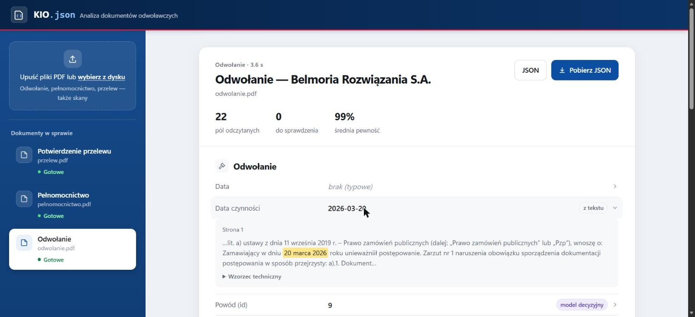
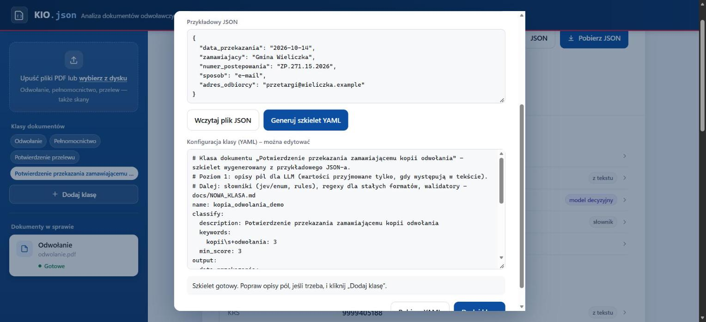

# odwolanie2json

Konwersja dokumentów sprawy odwoławczej KIO (odwołanie, pełnomocnictwo, potwierdzenie przelewu) z PDF do JSON
zgodnego z kanonicznym modelem UZP – hybryda reguł konfigurowanych w YAML, otwartego modelu decyzyjnego i LLM,
z cytatem źródłowym dla każdej wartości.

Bez zmian w kodzie (pliki YAML) konfiguruje się: klasy dokumentów, reguły rozpoznawania, ekstrakcję pól, normalizację,
walidację (także reguły między polami) i mapowanie na strukturę JSON.

Dokumentacja: [architektura](docs/ARCHITEKTURA.md) · [jak dodać nową klasę dokumentu](docs/NOWA_KLASA.md)
(przykład klasy dodanej samym YAML-em: `config/doctypes_examples/kopia_odwolania.yaml`).

## Uruchomienie

Wymagania: Python 3.13+, klucz API dostawcy modeli w pliku `.env` (wzór: `.env.example`; domyślnie `PRIVATEMODE_API_KEY`).

```bat
start.bat
```
albo
```bash
pip install -r requirements.txt
python -m app --input input --output output [--trace trace] [-v]
```

Docker Compose:
```bash
docker compose up -d web       # interfejs web: http://localhost:8000
docker compose run --rm cli    # tryb wsadowy: ./input/<sprawa>/*.pdf -> ./output/<sprawa>/*.json
```

Testy (bez sieci i kosztów): `pip install -r requirements-dev.txt && pytest`

- `input/caseN/*.pdf` → `output/caseN/<ta sama nazwa>.json`
- Dokument spoza klas (np. ogłoszenie TED) daje plik z pustym obiektem `{}` (ustalenie z organizatorem).
- `trace/` zawiera dla każdego pola: wartość, metodę (regex/reguła/enum), wzorzec i fragment źródłowy (transparentność).

Ocena na serwerze organizatora: komenda w [RUN.md](RUN.md) (`sudo docker compose --profile cli run --rm cli`
w `/opt/solution`; obraz zbudowany wcześniej, klucz w `/opt/solution/.env`).

## Interfejs webowy (prototyp do wgrywania dokumentów)

Uruchomienie: `start_web.bat`, `python -m app.web --port 8000` albo `docker compose up -d web`
(na serwerze oceny usługa `web` działa stale na porcie 8000 i startuje sama po restarcie – `restart: unless-stopped`).
Adres: http://localhost:8000 (na serwerze: `http://<adres-serwera>:8000`).



Co pokazuje:
- **Wgrywanie:** przeciągnij jeden lub kilka PDF-ów (także skany bez warstwy tekstowej) – każdy dokument przetwarzany
  osobno, ze wskaźnikiem przetwarzania.
- **Wynik:** rozpoznany typ dokumentu i czas przetwarzania; każda sekcja JSON (np. `OdwolanieKIO`, `Odwolujacy`,
  `Zamawiajacy`) jako osobny panel z polami.
- **Skąd wartość:** kliknięcie pola pokazuje **dokładny cytat** z dokumentu (numer strony, podświetlony fragment
  w kontekście), metodę (regex / reguła / model decyzyjny z prawdopodobieństwem / LLM ugruntowany w tekście) i użyty
  wzorzec albo pytanie do modelu.
- **Do sprawdzenia:** lista pól brakujących i niezwalidowanych (np. zła suma kontrolna) z komunikatem; pola, których
  brak jest normalny (np. brak PESEL), są oznaczone osobno.
- **Pobranie:** podgląd i pobranie JSON (dokładnie ten sam wynik co w trybie wsadowym).
- **Dodaj klasę** (panel po lewej): nazwa, słowa kluczowe, opis i przykładowy JSON -> szkielet konfiguracji YAML
  (edytowalny) -> klasa działa od razu dla kolejnych wgranych PDF-ów; „Pobierz YAML” = plik do `config/doctypes/`.
  Klasy dodane w interfejsie żyją w pamięci serwera web (tryb wsadowy oceny ich nie widzi); trwale – plik YAML.



Serwer bez dodatkowych zależności (`http.server`). API: `POST /api/process` (treść = PDF, nagłówek `X-Filename`;
odpowiedź: JSON wynikowy + ślad + statusy pól), `GET /api/health`, `GET /api/classes`,
`POST /api/class/preview` (szkielet YAML z przykładowego JSON-a), `POST /api/class` (dodanie klasy).

## Przepływ danych

```
input/<sprawa>/<plik>.pdf
  │ 1. tekst      app/pdf_text.py – pdfplumber (układ strony) + pypdfium2 (kolejność strumienia, tabele)
  │               brak warstwy tekstowej (skan) -> render strony -> OCR modelem wizyjnym (najpierw 1 strona)
  │ 2. typ        app/pipeline.py – punkty za słowa kluczowe z `classify` każdej klasy YAML;
  │               wynik niepewny -> model decyzyjny wybiera klasę albo „inny dokument” -> zapis {} i koniec
  │               (skan: OCR pozostałych stron tylko w liczbie potrzebnej tej klasie)
  │ 3. ekstrakcja app/engine.py – interpreter config/doctypes/<klasa>.yaml:
  │               a) sekcje dokumentu (kotwice), regexy, reguły, słowniki, normalizatory
  │               b) model decyzyjny: wybór spośród kandydatów (np. która data jest datą czynności),
  │                  pola-wybory (powód odwołania), liczność list, wskazanie elementu listy
  │               c) LLM – jedno wywołanie, tylko dla pól i list, które nadal są puste; JSON Schema;
  │                  wartość przyjęta tylko, jeśli występuje w tekście (ugruntowanie)
  │ 4. walidacja  app/validate.py – `checks` / `cross_checks` z YAML; błąd = status `invalid`, wartość zostaje
  │ 5. statusy    app/status.py – found / invalid / absent_ok / not_applicable / missing
  ▼
output/<sprawa>/<plik>.json   (struktura z `output:` w YAML = model kanoniczny UZP)
trace/<sprawa>/<plik>.json    (dla każdego pola: wartość, metoda, cytat, strona, kontekst, wzorzec/pytanie, pewność, status)
```

- Dokumenty przetwarzane równolegle (8 wątków); budżet czasu na dokument 150 s – po jego przekroczeniu bez dalszych
  wywołań modeli (wynik z reguł). Uszkodzony PDF lub błąd -> `{}`, reszta partii działa dalej.
- Wszystkie wywołania modeli idą przez `app/backend.py` (profil dostawcy, ogranicznik zapytań, ponowienia, licznik kosztu).

Szczegóły: [docs/ARCHITEKTURA.md](docs/ARCHITEKTURA.md). Biblioteki: PyYAML (MIT), pdfplumber / pdfminer.six (MIT),
pypdfium2 (BSD-3 / Apache-2.0), Pillow (MIT-CMU) – wyłącznie licencje permisywne.

## Dostawca modeli: Privatemode (UE)

Wersja dla jury używa **Privatemode** (Edgeless Systems GmbH, Niemcy) – usługi z API zgodnym z OpenAI, przetwarzającej
dane wyłącznie na serwerach w UE, w poufnym środowisku (szyfrowana pamięć), bez przechowywania promptów. Model:
**GLM-5.3-Flash** (licencja MIT, otwarte wagi – możliwa instalacja lokalna) w trzech rolach: OCR skanów (wejście obrazem),
model decyzyjny (klasyfikacja i wybory, prawdopodobieństwa z `logprobs`) oraz uzupełnianie pustych pól (structured output).

Dlaczego Privatemode: regulamin wymaga otwartych modeli i API u usługodawcy na serwerach w UE (OpenRouter kieruje zapytania
poza UE – zostawiony tylko do porównań); API przyjmuje `logprobs` i ograniczenie tokenów, co pozwala na model decyzyjny
z kalibrowaną pewnością; endpoint bez lokalnego proxy (`https://proxyless-api.privatemode.ai/v1`) – nic do instalowania;
jeden model obsługuje tekst i obrazy. Koszt: €0.20 / €0.65 za 1M tokenów (wejście / wyjście), czyli €0.07–0.30 na
1000 dokumentów tekstowych. Zmiana dostawcy: jedna linia `provider:` w `config/settings.yaml` (lub zmienna `PROVIDER`).

Modele (po API, bez GPU lokalnie) – dostawca w `config/settings.yaml` (`provider`, `decisions.provider`):

| rola | **`privatemode` (domyślny, wersja dla jury – UE)** | `openrouter` (porównawczo, poza UE) | `ollama` / `jev_local` (nasze serwery) |
|---|---|---|---|
| decyzje (klucz `jev:` w YAML) | **GLM-5.3-Flash** (MIT) – technika System One na logprobs | cloudflare/clef-flash (Apache 2.0, `/systemone`) | JEV-9B (Apache 2.0, vLLM `/v1/decide`) |
| ekstrakcja (klucz `llm:`) + OCR skanów | **GLM-5.3-Flash** (MIT, obrazy) | gemma-4-31b-it (Apache 2.0) | gemma4:31b (Ollama, pula hostów) |

Zgodność z regulaminem: wyłącznie otwarte modele z możliwością instalacji lokalnej (licencje MIT / Apache 2.0 sprawdzone na
Hugging Face), API u usługodawcy i na serwerach w UE – Privatemode (Edgeless Systems GmbH, Niemcy; przetwarzanie wyłącznie
w UE, bez przechowywania promptów). Endpoint bez lokalnego proxy: `https://proxyless-api.privatemode.ai/v1`.
Limit dostawcy (plan Standard) 100 zapytań/min – klient ma własny ogranicznik (`rate_limit_rpm` w profilu) i czeka zamiast
dostawać HTTP 429.

Konfiguracja klucza: skopiuj `.env.example` do `.env` i wpisz `PRIVATEMODE_API_KEY` (plik `.env` jest w `.gitignore`).
Bez klucza działa część regułowa (z ostrzeżeniem przy starcie).
Zmienne: `PROVIDER`, `DECISION_PROVIDER`, `OPENAI_BASE_URL`, `OPENAI_MODEL`, `DECISION_MODEL`, `JEV_URL`, `LLM_URL`,
`LLM_DISABLE=1`, `JEV_DISABLE=1`, `WORKERS`.

- `config/doctypes/*.yaml` – **jedna klasa dokumentu = jeden plik**: klasyfikacja, sekcje (kotwice), struktura wyjściowego JSON, regexy, reguły, słowniki, normalizatory. Nowy typ dokumentu = nowy plik YAML, bez zmian w kodzie.
- `app/engine.py` – interpreter konfiguracji (opis składni w docstringu).
- `app/normalize.py` – normalizatory: `date`, `amount`, `account`, `ted`, `person`, `digits`, `nospace`, `ws`, `strip`, `int`.
- `eval/evaluate.py` – F1 per pole na zbiorze treningowym.

## Wyniki

Obecna wersja: dostawca Privatemode (UE), model GLM-5.3-Flash, ekstrakcja tekstu pdfplumber/pypdfium2. Porównanie z dwoma
oczywistymi podejściami: **same regexy** (nasze reguły z YAML, bez modeli) i **samo LLM** (ten sam model dostaje tekst
dokumentu i wzór JSON organizatora z komentarzami i zwraca cały JSON; typ dokumentu podany z góry).

**Na jakich danych** (każda sprawa = odwołanie + pełnomocnictwo + potwierdzenie przelewu, z wzorcowymi JSON-ami):

| zbiór | skąd | po co |
|---|---|---|
| treningowy UZP – 60 spraw, 180 PDF | dane organizatora (`dane/przyklad_01…60` w repozytorium zadania), syntetyczne | zgodność z wzorami UZP; na nich strojone reguły |
| nietypowe układy – zbiór kontrolny, 30 spraw, 90 PDF | nasz generator `eval/adversarial/gen.py`, inny seed niż zbiór do strojenia; **nieużywany przy strojeniu** | odporność na dokumenty inne niż treningowe: inne etykiety i kolejność sekcji, tabele, odmiana nazwisk („Pana Jana Nowaka”), różne formaty dat/NIP/IBAN/kwot, konsorcja, potwierdzenie banku po angielsku, rozpraszające daty, brakujące pola |
| skany – 30 spraw, 90 PDF | `eval/make_scans.py`: 15 spraw treningowych + 15 kontrolnych wyrenderowanych jako obraz (150 dpi, szarość, obrót, rozmycie, szum), **bez warstwy tekstowej** | OCR i czas przetwarzania partii skanów |

Ukrytego zbioru realnych spraw nie znamy – stąd dwa własne zbiory sprawdzające dokumenty spoza wzorca treningowego.

**Metryka** (`eval/evaluate.py`, przybliżenie oficjalnej): JSON spłaszczony do par (ścieżka pola, wartość), listy jako
multizbiory (bez kolejności); TP = wartość niepusta i równa wzorcowi, FP = niepusta i błędna, FN = wzorzec niepusty
i nietrafiony; para pusta/pusta się nie liczy. Podajemy micro-F1 ze wszystkich pól wszystkich dokumentów zbioru.

**Dokładność (F1)**

| zbiór | same regexy | **hybryda** | samo LLM |
|---|---|---|---|
| treningowy UZP (60 spraw, 180 PDF) | 0.998 | **0.998** | 0.905 |
| nietypowe układy – zbiór kontrolny (30 spraw, 90 PDF) | 0.563 | **0.881** | 0.822 |
| skany bez warstwy tekstowej (30 spraw, 90 PDF; regexy z OCR) | 0.600 | **0.907** | – |

**Wkład składników** (zbiór kontrolny – nietypowe układy, F1):

| wariant | F1 |
|---|---|
| same regexy/reguły | 0.563 |
| reguły + model decyzyjny (bez LLM) | 0.632 |
| reguły + LLM (bez modelu decyzyjnego) | 0.801 |
| **pełna hybryda** | **0.881** |

Model decyzyjny i LLM uzupełniają się: każdy z osobna podnosi wynik, razem dają najwięcej.

**Czas i koszt** (czas na dokument mierzony sekwencyjnie)

| zbiór | hybryda | samo LLM |
|---|---|---|
| treningowy UZP | **0.55 s, €0.07 / 1000 dok.** | 3.03 s, €0.62 / 1000 dok. |
| nietypowe układy | **2.44 s, €0.30 / 1000 dok.** | 2.57 s, €0.36 / 1000 dok. |
| skany | partia 90 skanów w 4.6 min (8 równolegle), €1.30 / 1000 dok. | – |

- Na znanych układach reguły wystarczają – hybryda daje ten sam wynik co same regexy, a model wkracza rzadko
  (91% pól z regexów, LLM w 14 na 180 dokumentów). Na nowych układach i skanach same regexy spadają do ~0.56–0.60,
  hybryda utrzymuje ~0.88–0.91. Względem „samego LLM” hybryda jest dokładniejsza na każdym zbiorze, a na typowych
  dokumentach kilka razy szybsza i tańsza.
- Skany: OCR tylko tylu stron, ile potrzebuje klasa (średnio 1.2 strony na dokument), strony równolegle; 150 skanów ≈ 8 min.
- Zbiory „nietypowe układy” i „skany” generują `eval/adversarial/gen.py` i `eval/make_scans.py` (inne etykiety i układy,
  tabele, odmiana nazwisk, formaty dat/NIP/IBAN, konsorcja, bank po angielsku; skany: obraz strony bez warstwy tekstowej).

Odtworzenie (dane organizatora sklonowane obok projektu, `../tasks/uzp`):
```bash
python eval/evaluate.py --data ../tasks/uzp/dane                     # F1 per pole
python eval/cost_report.py --data ../tasks/uzp/dane --mode hybrid    # + czas, koszt, udział metod (tryby: regex, llm_full)
python eval/summarize.py privatemode                                 # tabela z eval/results/privatemode/
```

## Wydajność

Dokumenty są przetwarzane równolegle (`pipeline.workers`, env `WORKERS`). Ogranicznik zapytań po stronie klienta
(`rate_limit_rpm` w profilu dostawcy) pilnuje limitu dostawcy; odpowiedzi HTTP 429 oznaczają odczekanie, nie utratę danych.
Pojedynczy dokument przez interfejs: ~0.3–1 s (typowy), ~3 s (nietypowy układ: model decyzyjny + LLM), skan ~6 s/stronę (OCR).
Przy profilu `ollama` zapytania idą do najmniej obciążonego hosta z puli `llm.base_url` (`app/ollama.py`).

## Ograniczenia
- Dostrojenie reguł na danych syntetycznych organizatora; nietypowe układy obsługują fallbacki modelowe
  (wyniki na danych adwersaryjnych powyżej). `czynnosc_powod_id` = 12 nie występuje w danych ani we wzorze.
- Bez klucza API działa tylko część regułowa (z ostrzeżeniem przy starcie).
